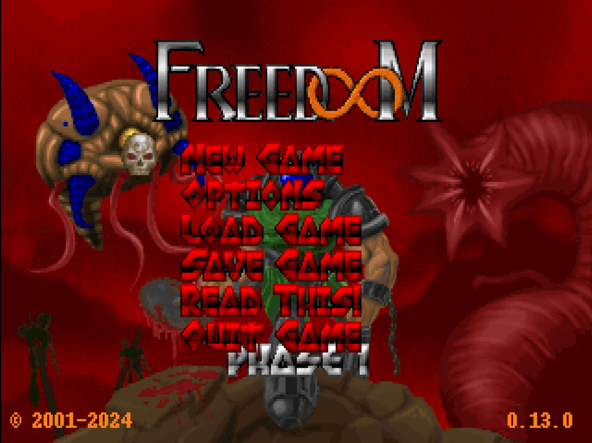

# Can It Run Doom?

A Windhawk mod that starts Doom fullscreen from anywhere with **Ctrl+Alt+Shift+D**. Press the shortcut again to return to the running game.

## Play fullscreen

The one-file build includes Crispy Doom 7.2.0 and both Freedoom campaigns. Import `build/doom-hotkey.wh.cpp` as a local mod in Windhawk. Leave **Doom executable** and **Game WAD** blank, choose a campaign, and press the shortcut. On first launch, the mod extracts the engine and selected campaign to `%LOCALAPPDATA%\Windhawk Doom`. Subsequent launches reuse the verified files. The game starts fullscreen and runs offline. The bundled x64 engine runs on x64 Windows and uses x64 emulation on Windows 11 on Arm.

Use **Game WAD** to play your own DOOM.WAD or DOOM2.WAD with the bundled engine. Freedoom provides the bundled levels, graphics, sounds, and music.

## Build the one-file mod

Use Python 3.11 or later on Windows. Create a `playable` folder next to this README and save these two release archives there with their original filenames.

1. [Crispy Doom 7.2.0 for 64-bit Windows](https://github.com/fabiangreffrath/crispy-doom/releases/download/crispy-doom-7.2/crispy-doom-7.2.0-win64.zip)
2. [Freedoom 0.13.0](https://github.com/freedoom/freedoom/releases/download/v0.13.0/freedoom-0.13.0.zip)

Run `python tools/embed.py` from the project folder. The script checks both archives against pinned SHA-256 hashes and writes `build/doom-hotkey.wh.cpp`.

To try the game before importing the mod, extract Crispy Doom into `playable/engine` and extract the Freedoom archive into `playable/game`. Run `Play Freedoom.cmd` to open Phase 1 fullscreen.

## Use an existing Doom installation

The smaller `doom-hotkey.wh.cpp` at the project root works with a Doom engine you already have. Import it as a local mod and set **Doom executable** to the engine’s full path. Set **Game WAD** to your own `DOOM.WAD`, `DOOM2.WAD`, or a compatible IWAD. Leave **Game WAD** blank if your engine finds the game data automatically.

Use a Doom source port that supports the `-fullscreen` argument.

The shortcut accepts Ctrl, Alt, Shift and Win modifiers followed by a letter, number or F1–F24. Windows reserves F12. If the new combination is unavailable, the previous one stays active. Windhawk's debug log shows invalid paths or shortcuts.

The mod registers a Windows hotkey in Explorer. Doom runs in its own process and keeps running if the mod is disabled.

## Credits

- **id Software** created DOOM and released its engine source. [DOOM source release](https://github.com/id-Software/DOOM)
- **Simon Howard and the Chocolate Doom contributors** developed the source port that Crispy Doom builds on. [Chocolate Doom](https://github.com/chocolate-doom/chocolate-doom)
- **Fabian Greffrath and the Crispy Doom contributors** maintain the engine used by this mod. [Crispy Doom 7.2.0](https://github.com/fabiangreffrath/crispy-doom/releases/tag/crispy-doom-7.2)
- **The Freedoom contributors** created the campaigns, graphics, sounds, and music included in the bundle. [Freedoom 0.13.0](https://github.com/freedoom/freedoom/releases/tag/v0.13.0)

## Licenses

The mod source and build tools use [GPL-2.0-or-later](LICENSE.md). See [third-party sources and licenses](THIRD-PARTY.md) for the bundled engine, Windows libraries, and Freedoom.
